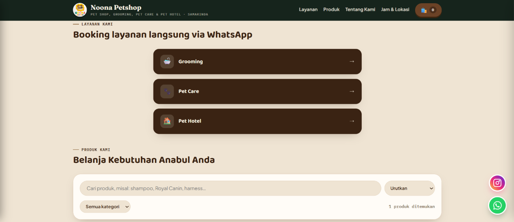

# Noona Petshop E-Katalog



Aplikasi e-katalog untuk Noona Petshop. Stack: Node.js + Express, PostgreSQL (Supabase), dan Supabase Storage untuk foto produk. Server tidak menyimpan data di disk lokal, jadi aman dipakai di hosting dengan filesystem sementara.

Ada tiga bagian:

- **Publik** (`/`): katalog produk dan layanan, pencarian/filter produk, keranjang, dan checkout yang membuka WhatsApp. Ada tombol WhatsApp mengambang di semua halaman.
- **Admin** (`/admin`): satu akun admin untuk mengelola produk, layanan (dengan varian harga), dan pesanan.
- **Data**: tabel di Supabase Postgres, foto di bucket publik `product-images`.

## Menjalankan di lokal

### 1. Siapkan project Supabase

1. Buat project baru di [supabase.com](https://supabase.com) dan catat password database-nya.
2. Di dashboard, buka **Connect** lalu salin connection string **Session pooler** ke `DATABASE_URL`. Jangan pakai Direct connection, karena hanya IPv6 dan sering gagal di hosting gratis.
3. Di **Project Settings > API**, salin **Project URL** ke `SUPABASE_URL` dan **service_role key** ke `SUPABASE_SERVICE_ROLE_KEY`. Key ini hanya untuk server, jangan diekspos ke frontend.

### 2. Install dan jalankan

```bash
npm install
cp .env.example .env   # isi DATABASE_URL, SUPABASE_URL, SUPABASE_SERVICE_ROLE_KEY, dst.
npm start              # http://localhost:3000
```

Saat pertama kali jalan dengan database kosong, server otomatis membuat tabel dan bucket foto, lalu mengisi data awal:

- 1 akun admin (dari `ADMIN_USERNAME` dan `ADMIN_PASSWORD_HASH`)
- 4 layanan grooming sesuai price list Noona Petshop
- Tabel produk dibiarkan kosong. Produk diisi lewat dashboard admin.

Login admin default (ganti setelah login pertama):

- URL: `http://localhost:3000/admin/login`
- Username: `admin`
- Password: `noona123`

### Environment variables

| Variabel | Keterangan |
|---|---|
| `DATABASE_URL` | Connection string Session pooler Supabase |
| `SUPABASE_URL` | Project URL |
| `SUPABASE_SERVICE_ROLE_KEY` | service_role key (rahasia) |
| `SESSION_SECRET` | Secret untuk cookie session |
| `ADMIN_USERNAME` | Username admin awal |
| `ADMIN_PASSWORD_HASH` | Hash password admin awal (lihat `scripts/hash-password.js`) |
| `WA_NUMBER` | Nomor WhatsApp toko, format `628xxxxxxxxxx` |
| `NODE_ENV` | Set `production` saat deploy (mengaktifkan cookie `secure`) |

## Migrasi dari SQLite

Hanya perlu kalau sebelumnya memakai versi SQLite. Skrip ini memindahkan akun admin, produk, layanan, pesanan, dan mengunggah foto lama ke Supabase Storage. Data SQLite tidak diubah dan skrip aman dijalankan ulang (data yang sudah ada dilewati).

```bash
npm install --no-save better-sqlite3   # hanya untuk migrasi
npm run migrate-from-sqlite            # atau: node scripts/migrate-from-sqlite.js path/ke/noona.db
```

Syarat:

- `data/noona.db` (beserta `noona.db-wal` dan `noona.db-shm` kalau ada) dan folder `public/uploads/products/` masih ada di folder proyek.
- Jalankan sebelum membuka dashboard admin pertama kali di database baru.

## Deploy (contoh: Render, paket gratis)

- Build command: `npm install`
- Start command: `npm start`
- Isi semua variabel dari `.env.example` di pengaturan environment hosting, terutama `DATABASE_URL`, `SUPABASE_URL`, `SUPABASE_SERVICE_ROLE_KEY`, `SESSION_SECRET`, dan `ADMIN_PASSWORD_HASH`. Set juga `NODE_ENV=production`.
- Jangan upload `.env` dan `node_modules` ke git.
- Server gratis akan tidur kalau lama sepi, jadi request pertama setelahnya akan lambat.

## Fitur

### Produk

- CRUD produk dari dashboard admin, foto diunggah ke Supabase Storage (JPG/PNG/WEBP, maks 3 MB).
- Stok memakai toggle **Tersedia / Habis**, bukan angka. Perubahan langsung tersimpan saat diklik. Dipilih karena toko tidak melacak jumlah stok.
- Ketersediaan tidak berubah otomatis saat ada pesanan. Admin mengaturnya manual di tab Produk.

### Layanan

Layanan dibagi tiga kategori. Halaman publik memakai rute `/layanan/<kategori>`: pelanggan memilih kategori dulu, lalu melihat daftar layanannya. Kategori atau layanan yang kosong menampilkan "Segera hadir", jadi isinya bisa ditambah atau dikosongkan dari dashboard tanpa ubah kode.

**Grooming** (4 layanan hasil seed, harga per ukuran S/M/L/XL/XXL):

- Basic Grooming: mandi, potong kuku, bersihkan telinga, parfum
- Treatment Grooming: mandi shampo khusus jamur dan kutu, potong kuku, bersihkan telinga, parfum
- Luxury Grooming: mandi shampo mewah, potong kuku, rapikan bulu kaki, bersihkan telinga, parfum
- Other Treatment: item à la carte (Lion Cut, Paw/Butt Trimming, Nail Trimming, Ear Cleaning, Matted Shaved)

**Pet Care** (6 layanan, tanpa harga tetap; halaman kategori memuat catatan "Harga disesuaikan dengan treatment yang diberikan"):

- Check Up
- Konsultasi
- Vaksin
- Home Visit
- Steril Jantan & Betina
- Minor Surgery

**Pet Hotel** (harga per hari, ditampilkan sebagai kartu horizontal bertumpuk):

- Pet Hotel: Rp 40.000/hari (include pasir) atau Rp 45.000/hari (include pasir dan pakan standar). Syarat: anabul sehat, bebas jamur/kutu, sudah vaksin minimal pertama dan membawa buku vaksin.
- Rawat Inap: Rp 55.000/hari, untuk masa pemulihan

Form layanan di admin punya editor varian dinamis (nama varian + harga, tombol "+ Tambah varian" dan ✕ per baris). Bisa dipakai untuk varian ukuran maupun daftar item flat, di mana tiap item menjadi satu varian.

Jam operasional ditampilkan sebagai banner di halaman publik: Pet Shop dan Pet Clinic 09.00-21.00, Pet Grooming 09.00-16.00, tutup tiap Kamis.

### Pesanan

Status pesanan hanya tiga:

| Kode | Label |
|---|---|
| `menunggu_pembayaran` | Menunggu Pembayaran (status awal saat checkout) |
| `dibayar` | Telah Dibayar |
| `dibatalkan` | Dibatalkan |

Status diubah manual oleh admin di tab Pesanan setelah mengecek pembayaran.

## Alur belanja

1. Pelanggan menambah produk ke keranjang. Keranjang disimpan di `localStorage`, jadi tidak hilang saat refresh.
2. Klik "Pesan Sekarang" memanggil `POST /api/orders`. Nama dan harga produk dihitung ulang dari database, bukan dari data yang dikirim browser. Status awal: Menunggu Pembayaran.
3. Browser membuka chat WhatsApp ke `WA_NUMBER` dengan pesan berisi nomor order, daftar item, dan total, lalu keranjang dikosongkan. Pesan memakai teks polos tanpa emoji.
4. Admin mencocokkan pesanan di tab Pesanan dengan chat WhatsApp dan bukti transfer, lalu mengubah status.

Tidak ada payment gateway atau QR code. Pembayaran dikonfirmasi manual lewat WhatsApp.

Layanan tidak lewat keranjang. Booking dilakukan langsung via WhatsApp karena berupa jadwal kunjungan, bukan barang.

## Autentikasi admin

- Akun disimpan di tabel `users`, session di tabel `session` pada database yang sama (cookie `httpOnly`), sehingga admin tidak ter-logout saat server restart.
- Middleware `requireAuth` mengunci `/admin/dashboard` dan semua API tulis.
- Ganti password lewat ikon 🔑 di dashboard, atau:

```bash
node scripts/reset-admin-password.js password-baru
```

## Struktur proyek

```
server.js                    Entry point Express, session (Postgres), routing
middleware/
  auth.js                    requireAuth, mengunci route dan API admin
  async.js                   wrap(), meneruskan error route async ke error handler
routes/
  auth.routes.js             login, logout, cek status login, ganti password
  products.routes.js         GET publik; POST/PUT/DELETE admin; toggle ketersediaan; upload foto
  services.routes.js         GET publik (filter ?category=); POST/PUT/DELETE admin
  orders.routes.js           POST publik (buat pesanan); GET/PATCH admin (status)
db/
  connection.js              Koneksi Postgres, skema tabel, seed admin dan layanan
  storage.js                 Upload/hapus foto di Supabase Storage
  products.js, services.js,
  orders.js, users.js        Query per tabel
scripts/
  hash-password.js           Cetak hash password untuk .env
  reset-admin-password.js    Reset password admin langsung di database
  migrate-from-sqlite.js     Migrasi data dan foto dari SQLite ke Supabase
public/                      Frontend publik (index.html, css, js, logo)
admin/                       Frontend admin (login.html, dashboard.html, css, js)
```

## Keamanan dan backup

- `.env` berisi rahasia (`SESSION_SECRET`, `SUPABASE_SERVICE_ROLE_KEY`, password database). Jangan di-commit; sudah masuk `.gitignore`. Kalau pernah ter-commit, anggap bocor dan ganti semuanya: password database, service_role key, `SESSION_SECRET`, dan password admin.
- Semua tabel memakai Row Level Security tanpa policy, jadi tidak bisa dibaca lewat anon key. Hanya server ini yang mengakses database.
- Bucket `product-images` bersifat publik. Yang dikunci hanya proses upload.
- Ganti password admin default sebelum online.
- Backup berkala: ekspor data (Export CSV di Table Editor Supabase, atau `pg_dump`) dan simpan salinan foto dari bucket.
- Cek kebijakan paket gratis Supabase di situs resminya. Project bisa dijeda kalau lama tidak ada aktivitas.